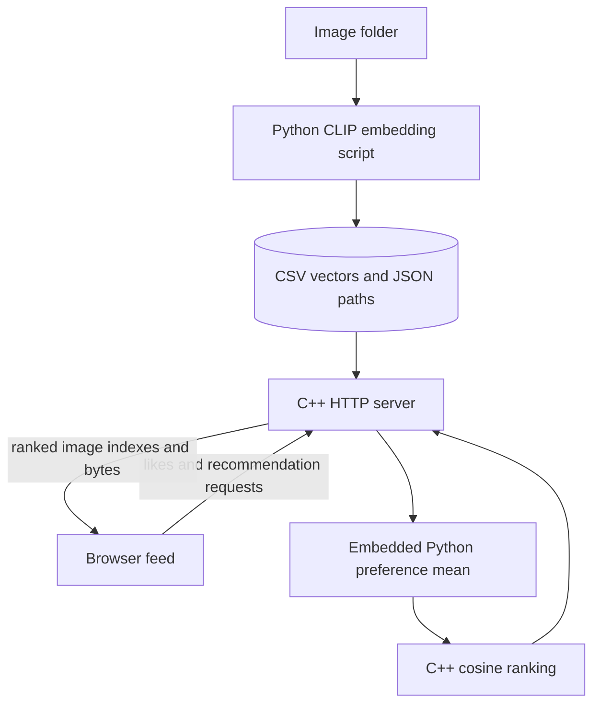

# Meme Feed — C++ / Python recommendation prototype

**A local scrolling meme feed that ranks image embeddings in C++ and computes a like-based preference vector through embedded Python.**

The project explores a simple personalization loop: represent images as vectors, average the vectors a user likes, and retrieve similar images. It is a small content-based recommendation prototype, not a trained ranking service.

- C++ HTTP routes serve recommendations, image files, status and feedback.
- Python loads CLIP ViT-B/32 for image embedding; an offline script writes vectors and paths.
- A C++ cosine-similarity scan ranks candidates; Python computes the normalized mean of liked vectors.
- A browser feed displays images, sends likes and requests refreshed recommendations.

**Ownership:** a collaborative repository. Albert authored the [CLIP recommender integration commit](https://github.com/Albert-bit07/Memewebsite/commit/bb6ad40a65eae81cee159e1aaf0b4f2e9fee0568); other contributors appear in history.

**Stack:** C++17 · cpp-httplib · nlohmann/json · pybind11 · Python · NumPy · PyTorch/OpenAI CLIP · HTML/CSS/JavaScript.

[Demo and setup](docs/demo.md) · [Engineering details](docs/project-overview.md)

## Architecture



Source-derived illustration. [embed_memes.py](backend/python/embed_memes.py) creates vectors, [py_recommender.py](backend/python/py_recommender.py) averages likes, [recommender.cpp](backend/cpp/recommender.cpp) sorts cosine scores, and [main.cpp](backend/cpp/main.cpp) serves the browser's requests. [script.js](frontend/script.js) calls loopback port 18080.

## How ranking works

Each stored image has a vector. Likes add unique indexes to one process-global list. Python averages those rows and normalizes the mean; C++ compares it against every candidate and fully sorts scores, returning up to 20. For N images of dimension D, this is O(ND + N log N), excluding Python conversion and preference computation. No index or approximate-nearest-neighbor service is used.

With no likes, the preference vector is zero and all scores tie; ordering is not a meaningful recommendation. Liked items are not filtered out. Unlike removes the index; repeated likes are idempotent. Skip leaves existing preferences unchanged. There are no separate users or durable preferences.

## Boundaries

The server binds loopback and keeps one process-global preference list. There is no authentication, persistent user store, request budget, recommendation evaluation or measured latency improvement. Keep it a single-user local demo. Dataset rights and vendored-header security/provenance still need review. CLIP regeneration and browser behavior have not been end-to-end validated.

## Runtime repairs and current build

The root CMake project now delegates to `backend/cpp`; Python is selected from the environment rather than a Windows-only Python 3.10 path. Serving committed vectors requires NumPy and pybind11; CLIP is needed only to regenerate embeddings. The interpreter has scoped ownership, the listener releases the GIL, and request threads acquire it for Python work. Preferences remain process-global: use this as a single-user local demo. Likes are idempotent, unlike removes a like, invalid actions/indices return 400, and preference reads share the same mutex as writes. Image paths are relative to the `backend` working directory.

```bash
python -m pip install numpy pybind11
cmake -S . -B /tmp/meme-build
cmake --build /tmp/meme-build -j2
ctest --test-dir /tmp/meme-build --output-on-failure
python tests/server_smoke.py /tmp/meme-build/backend/cpp/recommender
# Interactive server: run /tmp/meme-build/backend/cpp/recommender from backend/
```

For ranking-only checks without Python development libraries, configure with `-DBUILD_SERVER=OFF`. Invalid CSV values/dimensions and mismatched manifests fail at load; failed reloads preserve the prior dataset. Ranking rejects malformed vectors and breaks ties by index. Core regression tests pass locally. Hosted CI builds the full server and passes the HTTP smoke test, including concurrent recommendation requests, likes/unlike, invalid feedback and image serving. The local environment lacks the Python embedding library. No throughput/latency improvement is claimed. Existing checked-in Windows build artifacts remain historical and are not used by these commands.
