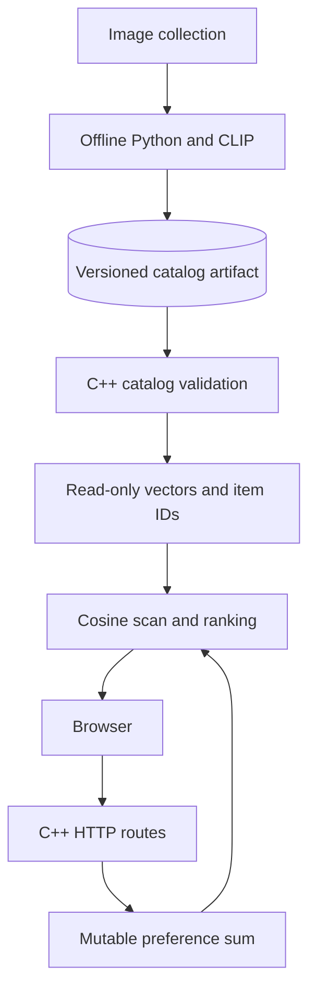

# Meme Feed — native recommendation serving

**A C++ recommendation server with an offline Python embedding pipeline and a browser meme-feed demo.** Image vectors are prepared once; recommendation requests do not start Python, load CLIP or cross a language boundary.

The current retrieval baseline is deliberately straightforward: maintain a vector sum for liked images, normalize it, scan the immutable catalog with cosine similarity, and sort the scores. This makes storage, concurrency and retrieval improvements independently testable.

## Architecture



Python generates vectors, images and a manifest into a new artifact directory. C++ validates metadata, dimensions, item IDs, file paths and vector values before replacing a loaded catalog. A failed load leaves the previous catalog intact. The server loads its catalog at startup; live HTTP catalog replacement is not yet exposed.

## Build and run

Serving requires a C++17 compiler, CMake and threads. Python is only needed for the test driver or offline generation, not the server executable.

```bash
cmake -S . -B build-native
cmake --build build-native -j2
ctest --test-dir build-native --output-on-failure
python tests/server_smoke.py build-native/backend/cpp/recommender
python -m unittest discover -s tests -p 'test_*.py' -v
cd backend
../build-native/backend/cpp/recommender
```

Open `frontend/index.html` in a browser while the server listens on `127.0.0.1:18080`. You can pass an alternate manifest path as the server's first argument. Paths inside the manifest resolve relative to the manifest directory, not the process working directory.

## Catalog contract

`backend/data/catalog.json` describes the checked-in vectors. It intentionally records their model provenance as `unknown-legacy-provenance`: the repository contains a CLIP generator, but that does not prove exactly how the committed vectors were produced.

A schema-v1 manifest contains `catalog_version`, `model_version`, `dimension`, a relative CSV `vectors` path, and ordered `items` with unique stable IDs and relative image paths. Item order corresponds to vector rows. The generator derives IDs from the relative image filename; preserving filenames preserves identity across generations, while renaming changes identity. IDs are not vector indexes.

For a new image collection, install the offline pipeline's PyTorch, OpenAI CLIP, Pillow and NumPy dependencies in a separate environment, then run:

```bash
python backend/python/embed_memes.py /tmp/meme-catalog-v2 --version v2 --images /path/to/permitted/images
build-native/backend/cpp/recommender /tmp/meme-catalog-v2/catalog.json
```

The output directory must not exist. Files are assembled in a temporary sibling directory and renamed only after successful generation. An error removes that temporary artifact. CLIP regeneration has not been executed in the current validation; the artifact writer is tested with synthetic vectors.

## Preference and concurrency behavior

Likes and unlikes update a C++ vector sum incrementally. Duplicate likes and unlikes are idempotent at the HTTP boundary; removing the last like resets the sum exactly. A recommendation request copies the normalized preference under a short mutex, then releases it before scoring immutable vectors. Concurrent requests therefore do not hold the user-state lock through the full ranking scan.

The current ranking cost remains O(ND + N log N). No latency, throughput or quality improvement is claimed without measurements. Cold-start vectors are zero, ties use catalog order, and seen/liked items are not filtered yet.

## Current boundaries and next milestones

Preferences are still shared by the local process and disappear on restart. The next milestone is SQLite-backed independent sessions, feedback events, seen filtering and restart reconstruction. This is a loopback, single-user demo until that is complete. Dataset permissions, model provenance, browser behavior, rate limits and vendored-header review remain outstanding.

CI builds the full native server, runs catalog/preference regressions, exercises actual HTTP like/unlike and concurrent recommendations, and verifies image serving. Catalog tests reject invalid schema versions, dimensions, duplicate IDs and path traversal while preserving the prior loaded version. There is no production deployment or formal verification claim.

**Ownership:** collaborative repository; Albert authored the original [CLIP integration](https://github.com/Albert-bit07/Memewebsite/commit/bb6ad40a65eae81cee159e1aaf0b4f2e9fee0568). Subsequent engineering work is visible in commit and PR history.
