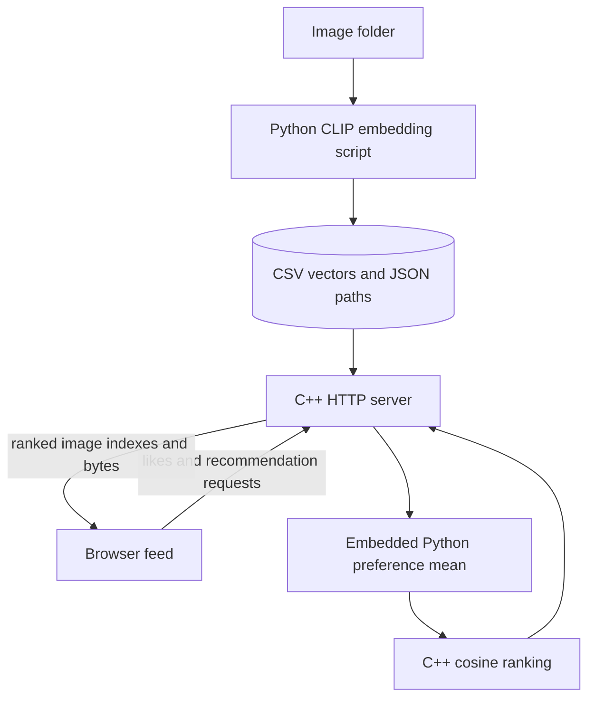

# Meme Feed — C++ / Python recommendation prototype

**A local scrolling meme feed that ranks image embeddings in C++ and computes a like-based preference vector through embedded Python.**

The project explores a simple personalization loop: represent images as vectors, average the vectors a user likes, and retrieve similar images. It is a small content-based recommendation prototype, not a trained ranking service.

- C++ HTTP routes serve recommendations, image files, status and feedback.
- Python loads CLIP ViT-B/32 for image embedding; an offline script writes vectors and paths.
- A C++ cosine-similarity scan ranks candidates; Python computes the normalized mean of liked vectors.
- A browser feed displays images, sends likes and requests refreshed recommendations.

**Ownership:** a collaborative repository. Albert authored the [CLIP recommender integration commit](https://github.com/Albert-bit07/Memewebsite/commit/bb6ad40a65eae81cee159e1aaf0b4f2e9fee0568); other contributors appear in history. Do not attribute the whole frontend or repository solely to Albert.

**Stack:** C++17 · cpp-httplib · nlohmann/json · pybind11 · Python 3.10 · NumPy · PyTorch/OpenAI CLIP · HTML/CSS/JavaScript.

[Demo and setup](docs/demo.md) · [Engineering details](docs/project-overview.md) · [Recruiting notes](docs/recruiting.md)

## Architecture



Source-derived illustration. [embed_memes.py](backend/python/embed_memes.py) creates vectors, [py_recommender.py](backend/python/py_recommender.py) averages likes, [recommender.cpp](backend/cpp/recommender.cpp) sorts cosine scores, and [main.cpp](backend/cpp/main.cpp) serves the browser's requests. [script.js](frontend/script.js) calls loopback port 18080.

## How ranking works

Each stored image has a vector. Likes append indexes to one process-global list. Python averages those rows and normalizes the mean; C++ compares it against every candidate and fully sorts scores, returning up to 20. For N images of dimension D, this is O(ND + N log N), excluding Python conversion and preference computation. No index or approximate-nearest-neighbor service is used.

With no likes, the preference vector is zero and all scores tie; ordering is not a meaningful recommendation. Liked items are not filtered out. A skip logs an action but does not remove a prior like; the browser's unlike display therefore differs from backend history. Duplicate likes can weight an image repeatedly. There are no separate users or durable preferences.

## Setup and evidence

See [the local setup and recording plan](docs/demo.md). Build from `backend/cpp`, **not the repository root**: the root CMake file references source files absent at that level. CMake currently requires Python **3.10 EXACT** and contains a Windows Python hint. The server must run with `backend` as its working directory. Committed paths are absolute Windows paths and must be regenerated for your machine in a disposable checkout.

On 2026-10-20, Python AST parsing passed for both scripts and `node --check frontend/script.js` passed. The stored dataset has 54 vector rows, each with 512 values, and 54 path entries whose basenames match committed images. This checks structure, not embedding provenance or relevance quality. CMake execution was blocked because `cmake` is absent; Python CLIP, torch and pybind11 are also absent. The HTTP server and browser flow were not executed. No test suite or CI workflow was found.

## Important boundaries

The HTTP library uses worker threads, while embedded Python calls lack an explicit GIL acquisition/release policy. The C++ mutex does not substitute for the Python GIL. Concurrent status/feedback access also needs review. These are unresolved runtime risks, not validated thread safety.

Feedback indexes are not range-validated before preference lookup. There is no authentication, persistent user store, request budget, recommendation evaluation or measured latency improvement. The server binds loopback; keep it local. Model initialization is required at startup even with precomputed vectors, and model weights may need downloading. Dataset rights and the pinned versions/provenance of vendored headers are not established. No public deployment or recording was produced by this review.

## Runtime repairs and current build

The root CMake project now delegates to `backend/cpp`; Python is selected from the environment rather than a Windows-only Python 3.10 path. Serving committed vectors requires NumPy and pybind11; CLIP is needed only to regenerate embeddings. The interpreter has scoped ownership, the listener releases the GIL, and request threads acquire it for Python work. Preferences remain process-global: use this as a single-user local demo. Likes are idempotent, unlike removes a like, invalid actions/indices return 400, and preference reads share the same mutex as writes. Image paths are relative to the `backend` working directory.

```bash
python -m pip install numpy pybind11
cmake -S . -B /tmp/meme-build
cmake --build /tmp/meme-build -j2
ctest --test-dir /tmp/meme-build --output-on-failure
python tests/server_smoke.py /tmp/meme-build/backend/cpp/recommender
# Interactive server: run /tmp/meme-build/backend/cpp/recommender from backend/
```

For ranking-only checks without Python development libraries, configure with `-DBUILD_SERVER=OFF`. Invalid CSV values/dimensions and mismatched manifests fail at load; failed reloads preserve the prior dataset. Ranking rejects malformed vectors and breaks ties by index. The local environment can compile/run core tests but lacks the Python embedding library; full HTTP validation is delegated to the added CI workflow. No throughput/latency improvement is claimed. Existing checked-in Windows build artifacts remain historical and are not used by these commands.
