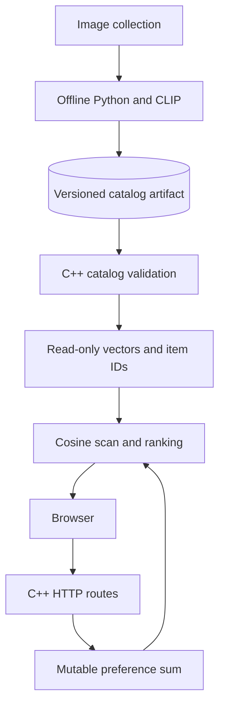

# Meme Feed — native recommendation serving

**A C++ recommendation server with an offline Python embedding pipeline and a browser meme-feed demo.** Image vectors are prepared once; recommendation requests do not start Python, load CLIP or cross a language boundary.

The current retrieval baseline is deliberately straightforward: maintain a vector sum for liked images, normalize it, scan the immutable catalog with cosine similarity, and select the highest scores. This makes storage, concurrency and retrieval improvements independently testable.

## Architecture



Python generates vectors, images and a manifest into a new artifact directory. C++ validates metadata, dimensions, item IDs, file paths and vector values before replacing a loaded catalog. A failed load leaves the previous catalog intact. The server loads its catalog at startup and supports an opt-in administrator reload of the configured manifest.

## Build and run

Serving requires a C++17 compiler, CMake, SQLite development headers/library and threads. On Ubuntu, install `libsqlite3-dev`. Python is only needed for the test driver or offline generation, not the server executable.

```bash
cmake -S . -B build-native
cmake --build build-native -j2
ctest --test-dir build-native --output-on-failure
python tests/server_smoke.py build-native/backend/cpp/recommender
python -m unittest discover -s tests -p 'test_*.py' -v
cd backend
../build-native/backend/cpp/recommender
```

Open `http://127.0.0.1:18080` in a browser; the C++ server serves the frontend from `../frontend` when launched from `backend/`. Separate browser profiles receive independent anonymous sessions. You can pass an alternate manifest path as the server's first argument, a SQLite database path as the second, and a frontend directory as the third. Paths inside the manifest resolve relative to the manifest directory, not the process working directory.

## Catalog contract

`backend/data/catalog.json` describes the checked-in vectors. It intentionally records their model provenance as `unknown-legacy-provenance`: the repository contains a CLIP generator, but that does not prove exactly how the committed vectors were produced.

A schema-v1 manifest contains `catalog_version`, `model_version`, `dimension`, a relative CSV `vectors` path, and ordered `items` with unique stable IDs and relative image paths. Item order corresponds to vector rows. The generator derives IDs from the relative image filename; preserving filenames preserves identity across generations, while renaming changes identity. IDs are not vector indexes. Artifact paths are resolved before containment validation: symlinks within the artifact are supported, but links outside it are rejected. Keep the artifact directory read-only while serving; validation does not protect against a local process changing files afterward.

For a new image collection, install the offline pipeline's PyTorch, OpenAI CLIP, Pillow and NumPy dependencies in a separate environment, then run:

```bash
python backend/python/embed_memes.py /tmp/meme-catalog-v2 --version v2 --images /path/to/permitted/images
build-native/backend/cpp/recommender /tmp/meme-catalog-v2/catalog.json
```

The output directory must not exist. Files are assembled in a temporary sibling directory and renamed only after successful generation. An error removes that temporary artifact. CLIP regeneration has not been executed in the current validation; the artifact writer is tested with synthetic vectors.

## Preference and concurrency behavior

Likes and unlikes update a C++ vector sum incrementally. Duplicate likes and unlikes are idempotent at the HTTP boundary; removing the last like resets the sum exactly. A recommendation request copies the normalized preference under a short mutex, then releases it before scoring immutable vectors. Concurrent requests therefore do not hold the user-state lock through the full ranking scan.

Warm ranking uses partial sorting for O(ND + N log K) work and O(N) score storage. [The reproducible synthetic benchmark](benchmarks/README.md) compares this path with full sorting and checks exact output equality. These in-process measurements do not establish HTTP throughput or recommendation quality. Cold-start preference vectors are zero; session-specific ordering supplies initial variety, and seen items are filtered.

## Persistent personalization

The browser obtains an opaque session cookie from `POST /session` (HttpOnly, SameSite=Strict). SQLite stores sessions, per-item liked/seen state and a transition event history. State changes and their events commit together before in-memory preferences change. Duplicate feedback does not add duplicate transitions. On restart, liked stable item IDs reconstruct each session's vector sum against the current catalog.

HTTP clients use the stable `id` returned by `GET /recommend`: send `{"id":"...","action":"like"}` (or `unlike`/`seen`) to `POST /feedback`, and fetch images through `GET /image?id=<URL-encoded-id>`. `GET /status` exposes `liked_ids`. Numeric `index` and `liked_indices` fields remain diagnostic positions in the current catalog, not request identifiers. Index-only feedback is rejected, and the old `/image/<index>` route is removed; reload older browser tabs after upgrading. Stable IDs ensure an existing client still targets the same item after a reordered catalog is loaded on restart. Removed IDs return 400 for feedback or 404 for images.

`GET /recommend` excludes items marked seen. The browser reports actual visibility through one shared intersection observer. New sessions use a deterministic session-specific cold-start order; this is exploration, not a claim of learned relevance. Removing the last like resets the preference exactly. Ranking happens after releasing the storage/state mutex. The derived-state cache is bounded at 1024 sessions; eviction leaves durable interactions intact.

## Current boundaries and next milestones

This remains a single-instance loopback demo. Anonymous cookies are not authenticated accounts; losing the cookie loses access to that session. There is no account recovery. Sessions expire 30 days after creation; new-session admission cleans up expired data. New-session attempts have a process-wide rate limit; other request routes do not. Do not run multiple server instances against the same database: their derived in-memory caches do not coordinate. Dataset permissions, model provenance, browser E2E, vendored-header review, concurrent-load measurements and relevance evaluation remain outstanding.

CI builds the full native server, runs catalog/preference regressions, and tests independent HTTP sessions, duplicate feedback, concurrent ranking, seen filtering and preference reconstruction across server restarts, including a reordered catalog and stable image/feedback identity. Catalog tests reject invalid schema versions, dimensions, duplicate IDs, path traversal and symlink escapes while preserving the prior loaded version. There is no production deployment or formal verification claim.

**Ownership:** collaborative repository; Albert authored the original [CLIP integration](https://github.com/Albert-bit07/Memewebsite/commit/bb6ad40a65eae81cee159e1aaf0b4f2e9fee0568). Subsequent engineering work is visible in commit and PR history.


## Replacing a catalog while serving

Set `MEME_ADMIN_TOKEN` to a locally generated random token of at least 32 characters before starting the server. Without it, the reload route returns 404. With it, `POST /admin/reload` requires `Authorization: Bearer <token>` and reloads only the manifest path passed at startup; requests cannot select a filesystem path. The token is not used by the public feed and must not be embedded in frontend code. This remains a loopback, single-instance demo.

Generate and validate a new artifact in a separate immutable directory, then atomically replace the configured manifest (or its parent-directory symlink) to point at it. Keep old artifact directories available until all requests using them finish; retaining them also permits rollback. Do not overwrite vector or image files in place. Send the authenticated reload request after publishing the manifest. Validation failure returns 422 and leaves the current catalog and preferences serving normally. A rejected reload does not repair the manifest on disk: restore a valid manifest before restarting the process. To roll back, restore the previous manifest and reload it.

Candidate loading and ID-map construction occur before publication, while ordinary requests continue. A shared catalog lock allows concurrent serving; reload takes the exclusive lock only after validation, clears derived user caches and publishes the catalog and lookup together. Each request holds its shared lock through ranking or image reading, so a reload may wait for a long request. Reload preparations are serialized to prevent an older candidate overtaking a newer one. Subsequent session access reconstructs preferences from SQLite stable IDs against the new vectors and dimension. Removed items disappear from current preferences but remain in history and are restored if reintroduced. This avoids holding the user-state mutex during candidate ranking; it is not a lock-free or multi-instance design.

The synthetic native HTTP reload test covers authorization, changed vector dimensions, reordered/removed/reintroduced IDs, invalid-artifact retention, concurrent reads and feedback during repeated updates, and restart persistence. It does not establish production load capacity or recommendation relevance.

### Revoking a session

`DELETE /session` uses the current `meme_session` cookie to revoke that session
and remove its preferences and feedback events in one SQLite transaction. It
expires the browser cookie only after commit. Repeating the request, including
with no cookie, succeeds without creating a session. Cross-site requests are
rejected by the same origin checks used by the other endpoints.

From the local demo's browser console:

```javascript
await fetch('/session', { method: 'DELETE' });
location.reload(); // The feed starts a new, empty session.
```

Deletion affects only the caller's session, and a copied old cookie remains
invalid after a server restart. A database failure returns 500 and retains the
session and its data so the request can be retried. This is logical deletion,
not a promise of physical erasure from SQLite pages, WAL files or backups.
Expired sessions are purged during new-session admission; database byte quotas and
per-client rate limits remain future work. Requests already in flight
may have read the previous session state before revocation commits.

### Session capacity

`MEME_MAX_SESSIONS` bounds the number of stored sessions (default **10000**;
accepted range **1–1000000**). Configure it before starting the native server:

```bash
MEME_MAX_SESSIONS=2000 ./build/backend/cpp/recommender backend/data/catalog.json data/users.sqlite3 frontend
```

Expired-session cleanup, the count check and creation share one SQLite transaction. At capacity,
`POST /session` returns **503** with a JSON error and no new cookie. Existing
sessions continue to work, including repeated `POST /session` calls with a valid
cookie. Deleting a session frees one slot. The count survives process restarts;
lowering the limit below the current count preserves live session data and
blocks new sessions until the count falls below the limit. Invalid configuration
fails startup before opening the user database.

This is an admission limit, not a measured serving-capacity recommendation or a
rate limiter. It does not cap database bytes or request rates. Per-client abuse
controls remain unimplemented; absolute session expiration is described below.

### Bounded transition history

Each successful state-changing feedback request retains only that session's
newest 1,000 transition events, ordered by database ID. Event insertion, preference
updates and pruning commit together; any failure rolls them all back before
changing the in-memory preference. Duplicate feedback creates no transition.
A `(session, id)` index supports scoped retention and session deletion.

The event log is a rolling diagnostic history, not a complete audit trail. Durable
per-item preferences are retained independently and reconstruct likes/seen state
after restart, even after their original events expire. Existing larger histories
are pruned on that session's next state-changing feedback request; startup and
duplicate requests do not delete history. Other sessions are unaffected. The
1,000-event limit is a storage policy, not a benchmark-derived capacity estimate.
SQLite may reuse freed pages without shrinking the database file, and preferences
for removed catalog IDs remain stored. This does not bound database bytes, request
rates, or total inactive-session storage.


### Session creation rate

`MEME_SESSION_CREATIONS_PER_MINUTE` limits new-session attempts in a rolling
60-second window (default **60**, integer range **1–60000**). Valid existing
cookies bypass this limiter, including repeated `POST /session` calls. New or
unknown cookies share one process-wide quota, so rotating cookies or client
addresses cannot bypass it. Exceeding the quota returns **429**, `Retry-After`
in whole seconds, a JSON error and `Cache-Control: no-store`, without a cookie
or database insertion. Creation attempts that reach storage consume quota even
if storage is at capacity or fails; deleting a session does not reset quota.

The bounded in-memory window uses a monotonic clock and a mutex. It resets on
server restart and is not shared between processes. This protects the local
demo's creation path, not every route or a public production service. A client
can consume the shared quota and delay other new visitors; existing sessions
continue working. The default is an explicit policy, not a measured capacity.
Other request limits and database byte quotas remain future work.


### Revocation during a request

If revocation commits after pre-routing authentication but before a handler's
session-state access, that access returns **401** with a no-store JSON error.
Unknown sessions have a distinct storage exception, so valid feedback is not
misreported as invalid item/action input and reads do not become internal errors.
Malformed feedback for a valid session still returns 400; unexpected storage
errors remain generic 500 responses. Requests that already took their snapshot
may finish using that snapshot. This does not cancel in-flight responses.

The regression orders authentication, revocation and handler-state access
explicitly against SQLite and checks the production exception classifier. HTTP
smoke tests cover normal revoked cookies; no probabilistic timing test or browser
E2E is claimed for this race.


### Absolute session expiration

Sessions expire **30 days after creation**, matching the cookie's `Max-Age`.
Server-side checks enforce the limit even with a manually replayed cookie or
cached preferences. Activity and repeated `POST /session` calls do not extend
the lifetime. An expired session receives 401 on protected routes; posting to
`/session` creates a new, empty session subject to admission limits.

When a new session is admitted, one SQLite transaction removes expired tokens,
preferences and feedback events before checking stored-session capacity and
inserting the new session. A failure rolls back cleanup and creation together;
no replacement cookie is issued. The transaction captures a single expiration
cutoff, preserving foreign-key consistency at the boundary. Live users retain
all durable preferences. Cleanup is lazy: expiration is enforced on access, but
expired rows remain on disk until successful new-session admission. This is
logical deletion, not secure erasure or a database byte quota.

Existing rows use their stored `created_at` timestamp, so sessions already
30 days old expire immediately after upgrading. Back up the database before
adopting this retention policy. Server wall-clock accuracy is required; invalid
creation timestamps fail authentication but are not silently deleted. Tests age
isolated SQLite fixtures, cover rollback/restart/cache behavior, and do not
claim elapsed-30-day runtime or browser verification.

### Recommendation admission

`MEME_RECOMMENDATIONS_PER_MINUTE` caps admitted ranking attempts in a rolling
60-second window (default 600, integer range 1–60000). This independent,
process-wide quota applies after session validation and before catalog ranking.
Exhaustion returns 429 with a whole-second `Retry-After` and `Cache-Control: no-store`.
Unauthenticated requests still return 401 and do not consume ranking slots.
Feedback, status, image reads and session deletion do not consume this quota.

The bounded in-memory window uses a monotonic clock and synchronizes concurrent
admissions. Restart resets it; creating/deleting a session does not. Failed
admitted attempts consume a slot. One busy user can exhaust the shared quota;
this is a demo overload policy, not per-user fairness or measured capacity.
It does not bound authentication/storage work, concurrent connections or image
traffic. Multi-instance and public deployment abuse controls remain outstanding.

### Offline embedding resource cleanup

The Python helper closes the source image and converted RGB buffer after
preprocessing, including conversion/preprocessing failures. Model preparation
publishes its model, preprocessor and device only after loading and evaluation
mode succeed; a failed reload leaves the previous state intact. This helper is
for sequential offline generation, not concurrent model replacement.

The resource tests use controlled dependency stubs, so they run without torch,
CLIP, Pillow, model weights or GPU access. They do not establish actual CLIP
compatibility, output quality or memory benchmarks. The optional embedding
runtime still needs a declared, verified dependency environment; native C++
recommendation serving does not load that runtime.
